<div align="center">

# SynRL: Learning Transferable Temporal Primitives<br>for Video Reasoning via Synthetic Videos

### CVPR 2026

[](https://arxiv.org/abs/2603.17693)
[](https://github.com/jiangsongtao/Synthetic-Video)
[](LICENSE)

<p align="center">
  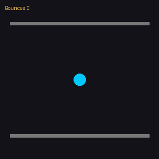&nbsp;
  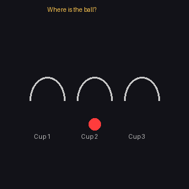&nbsp;
  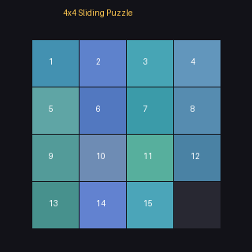&nbsp;
  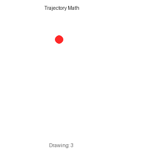
</p>

*Abstract temporal primitives learned from simple synthetic scenarios transfer effectively to complex real-world videos involving human actions, camera motion, and scene dynamics.*

</div>

---

## Highlights

| | |
|---|---|
| **No proprietary model dependency** | We bypass GPT-4V/Gemini for data synthesis. All training data is generated programmatically with provably correct annotations. |
| **21x data efficiency** | 7.7K synthetic CoT samples outperform Video-R1's 165K real-world CoT samples. |
| **Consistent gains across 15 benchmarks** | +12.6% on RexTime, +4.6% on TOMATO, with improvements on MVBench, VideoMME, TemporalBench, and more. |

---

## Method

SynRL is a post-training framework that teaches VLMs **temporal primitives** -- the fundamental building blocks of temporal understanding -- through programmatically generated synthetic videos with guaranteed ground-truth annotations.

<table>
<tr>
<td width="33%" align="center"><b>Stage 1</b><br>Programmatic Video Generation</td>
<td width="33%" align="center"><b>Stage 2</b><br>Chain-of-Thought Augmentation</td>
<td width="33%" align="center"><b>Stage 3</b><br>Two-Stage Training (SFT + GRPO)</td>
</tr>
<tr>
<td>Synthetic videos covering short-term perceptual and long-term cognitive primitives, generated via Python with frame-level metadata.</td>
<td>A four-stage pipeline (Generation &rarr; Verification &rarr; Reflection &rarr; Polishing) produces high-quality temporal reasoning chains.</td>
<td>(i) SFT on 7.7K CoT samples to teach reasoning structure; (ii) GRPO RL on 7K video-QA pairs with verifiable accuracy rewards.</td>
</tr>
</table>

---

## Synthetic Video Gallery

Our synthetic video suite covers **10 major categories** spanning short-term perceptual primitives and long-term cognitive primitives.

### Short-term Perceptual Primitives

<table>
<tr>
<td align="center" width="25%">
  <br>
  <b>Bouncing & Counting</b><br>
  <sub>Count collisions between objects and barriers</sub>
</td>
<td align="center" width="25%">
  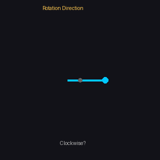<br>
  <b>Rotation Detection</b><br>
  <sub>Identify rotation direction and count</sub>
</td>
<td align="center" width="25%">
  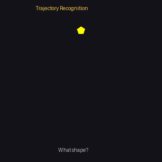<br>
  <b>Trajectory Recognition</b><br>
  <sub>Recognize geometric trajectory shapes</sub>
</td>
<td align="center" width="25%">
  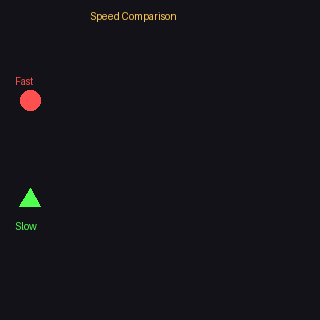<br>
  <b>Speed & Acceleration</b><br>
  <sub>Compare speeds and detect acceleration</sub>
</td>
</tr>
</table>

### Long-term Cognitive Primitives

<table>
<tr>
<td align="center" width="25%">
  <br>
  <b>Shell Game</b><br>
  <sub>Track hidden ball across cup swaps</sub>
</td>
<td align="center" width="25%">
  <br>
  <b>Sliding Puzzle</b><br>
  <sub>Track tile positions through 4&times;4 puzzle moves</sub>
</td>
<td align="center" width="25%">
  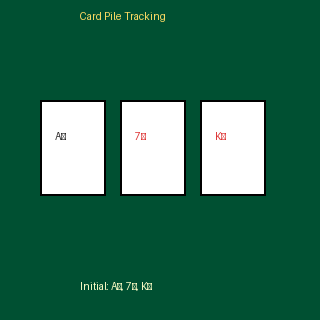<br>
  <b>Card Pile Tracking</b><br>
  <sub>Track add/remove operations on card stacks</sub>
</td>
<td align="center" width="25%">
  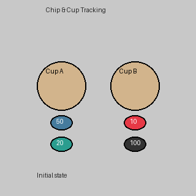<br>
  <b>Chip & Cup</b><br>
  <sub>Track casino chips across multiple cups</sub>
</td>
</tr>
<tr>
<td align="center" width="25%">
  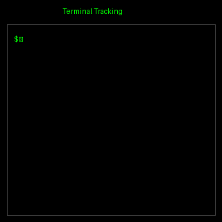<br>
  <b>Terminal Tracking</b><br>
  <sub>Track file operations in a terminal</sub>
</td>
<td align="center" width="25%">
  <br>
  <b>Trajectory Math</b><br>
  <sub>Recognize math expressions drawn by a ball</sub>
</td>
<td align="center" width="25%">
  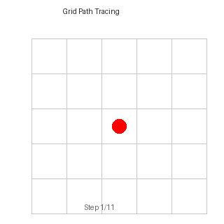<br>
  <b>Grid Path Tracing</b><br>
  <sub>Track long-distance paths on a 5&times;5 grid</sub>
</td>
<td align="center" width="25%">
  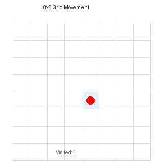<br>
  <b>8&times;8 Grid Movement</b><br>
  <sub>Long-range movement tracking and counting</sub>
</td>
</tr>
</table>

---

## Results

### Temporal Grounding

| Model | NExTGQA mIoU | RexTime mIoU | Charades mIoU |
|:------|:---:|:---:|:---:|
| Qwen3-VL-4B | 23.5 | 20.9 | 41.9 |
| **Qwen3-VL-4B + SynRL** | **28.1** (+4.6) | **28.9** (+8.0) | **47.0** (+5.1) |

### Complex Reasoning & General Understanding

| Model | TOMATO | Video-TT | MVBench | VideoMME |
|:------|:---:|:---:|:---:|:---:|
| Qwen3-VL-4B | 32.1 | 38.9 | 65.4 | 60.9 |
| **Qwen3-VL-4B + SynRL** | **36.7** (+4.6) | **40.7** (+1.8) | **67.1** (+1.7) | **62.0** (+1.1) |
| Qwen3-VL-8B | 33.2 | 40.6 | 67.2 | 63.4 |
| **Qwen3-VL-8B + SynRL** | **38.1** (+4.9) | **41.5** (+0.9) | **69.1** (+1.9) | **65.2** (+1.8) |

---

## Training Data

| Category | Count | Description |
|:---------|:-----:|:------------|
| Synthetic CoT (SFT) | 6.7K | Temporal reasoning chains with frame-level annotations |
| Real-world QA (SFT) | 1.0K | LLaVA-Video samples (answer-only, no CoT) |
| Synthetic RL | 7.0K | Video-QA pairs with verifiable rewards |

Synthetic videos span **10 major categories** with **18+ subcategories**, covering collision counting, direction identification, trajectory recognition, speed perception, rotation detection, grid-based tracking, symbol manipulation, code execution, and container management.

---

## Getting Started

### Requirements

- 8x NVIDIA H100 GPUs (80GB)
- Python 3.10+
- VeRL framework for GRPO training

### Generate Synthetic Videos

Each script generates one category of synthetic training videos:

```bash
# Generate all categories (1 example each)
python run_all_examples.py

# Or generate a specific category
python 01_atomic_motion.py        # Bouncing, rotation, trajectory, acceleration
python 02_atomic2_extended_motion.py  # Extended motion primitives
python 03_shell_game.py           # Shell game tracking
python 04_sliding_puzzle.py       # 4x4 sliding puzzle
python 05_card_pile.py            # Card pile operations
python 06_chip_cup.py             # Chip & cup tracking
python 07_terminal_tracking.py    # Terminal command tracking
python 08_trajectory_math.py      # Math expression trajectories
python 09_longterm_temporal.py    # Long-term temporal reasoning
python 10_grid_movement_tracking.py  # Grid movement tracking
```

---

## Acknowledgments

This work builds upon [Qwen3-VL](https://github.com/QwenLM/Qwen2.5-VL) and the [VeRL](https://github.com/volcengine/verl) framework.

## License

This project is released under the [Apache 2.0 License](LICENSE).

---

<div align="center">
  <sub>If you find this work useful, please consider citing our paper.</sub>
</div>

```bibtex
@article{jiang2026learning,
  title={Learning Transferable Temporal Primitives for Video Reasoning via Synthetic Videos},
  author={Jiang, Songtao and Song, Sibo and Zhou, Chenyi and Wang, Yuan and Chen, Ruizhe and Guan, Tongkun and Luo, Ruilin and Zhang, Yan and Tang, Zhihang and Sun, Yuchong and others},
  journal={arXiv preprint arXiv:2603.17693},
  year={2026}
}
```
